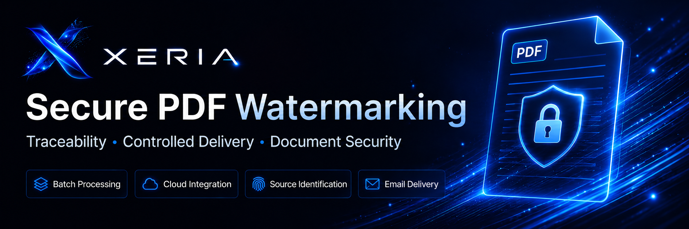
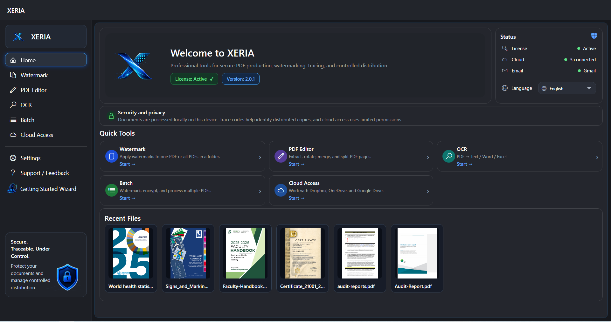
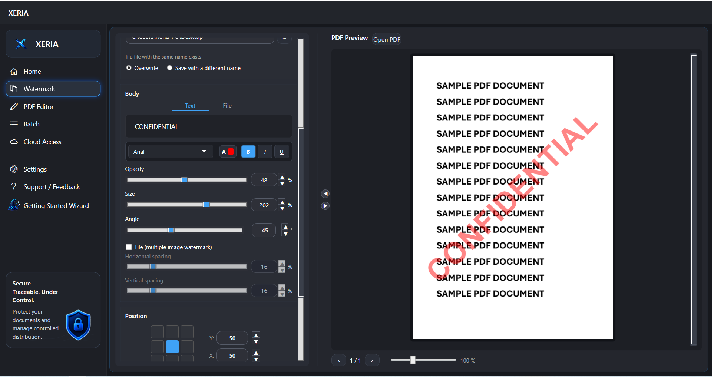
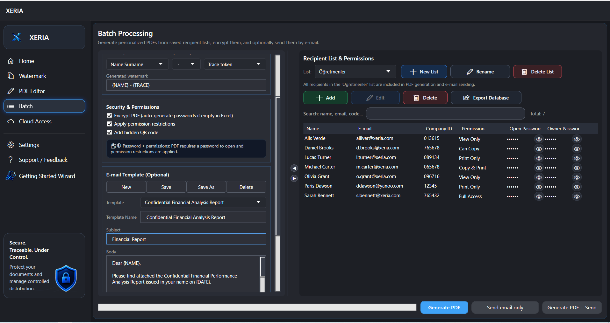
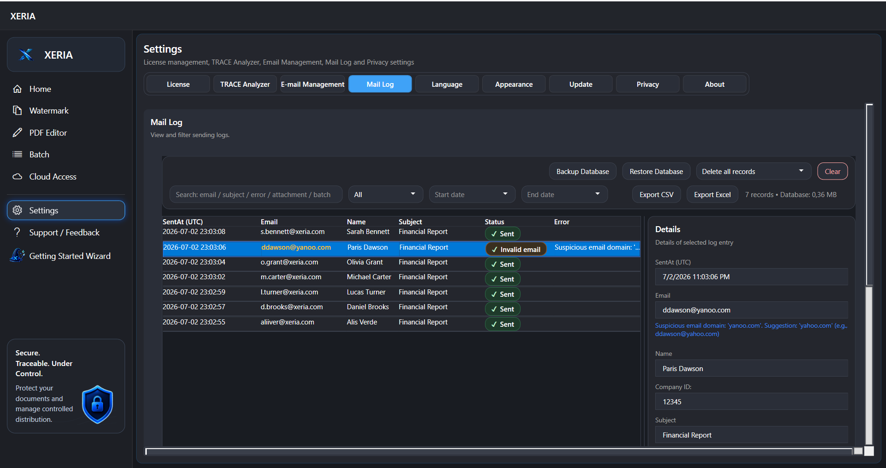
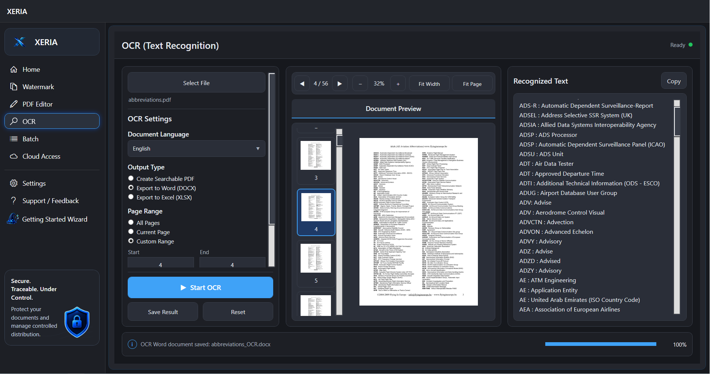

  

# XERIA

Secure PDF distribution with watermarking, source identification, password protection, email delivery, and traceability.

  <a href="https://xeriasoft.com">Official Website</a> •
  <a href="https://apps.microsoft.com/detail/9P37ZD7SQNZP">Microsoft Store</a> •
  <a href="https://xeriasoft.com/downloads/XERIA-setup.exe">Direct Installer</a> •
  <a href="https://xeriasoft.com/pricing.html">Pricing</a> •
  <a href="https://xeriasoft.com/video-tutorials.html">Video Tutorials</a>

XERIA is a Windows desktop application designed for organizations that need to distribute confidential PDF documents securely while maintaining traceability and delivery control.

It combines PDF watermarking, source identification, PDF encryption, personalized document generation, email delivery, cloud-connected workflows, and audit logging in a single workflow.

## Download and Installation

### Recommended: Microsoft Store

https://apps.microsoft.com/detail/9P37ZD7SQNZP

Current Microsoft Store version:

**XERIA 2.0.0** (2.0.1 in certification)

### Alternative: Direct Installer

https://xeriasoft.com/downloads/XERIA-setup.exe

Current direct installer version:

**XERIA 2.0.1**

## Current Distribution Channels

| Channel | Version | Status |
|---|---:|---|
| Microsoft Store | 2.0.0 | 2.0.1 submitted for certification on November 9, 2026 |
| Direct Installer | 2.0.1 | Available now from official website |

The direct installer is available as version 2.0.1. The Microsoft Store listing remains at 2.0.0 until the submitted 2.0.1 update is approved and published.

## Latest Update

### XERIA 2.0.1 — OCR Shortcut and Usability Improvements

Direct installer released: November 9, 2026. Microsoft Store submission for 2.0.1 is in certification.

Added an OCR shortcut to the home screen, refined PDF Editor and interface usability, and applied minor bug fixes. See [XERIA 2.0.1 release notes](docs/releases/RELEASE-NOTES-2.0.1.md).

### Previous update: XERIA 2.0.0 — Multilingual OCR and PDF Editor Improvements

Released: October 16, 2026 (Microsoft Store and direct installer).

XERIA 2.0.0 adds multilingual OCR to extract text from scanned and image-based PDF documents and export to Word, Excel, and searchable PDF formats. OCR supports nine document languages, improved table detection, page previews, progress tracking, cancellation, and remembered language selection.

The PDF Editor now supports expanding multi-page documents and reordering documents or individual pages with drag-and-drop directly in List View, synchronized with Thumbnail View. This release also refines localization and interface consistency.

See [CHANGELOG.md](CHANGELOG.md) and the [XERIA 2.0.0 release notes](docs/releases/RELEASE-NOTES-2.0.0.md).

## Key Features

* Secure PDF watermarking
* Personalized batch PDF generation
* Recipient-based Trace Code watermarking
* Optional QR-based document traceability
* PDF encryption and permission controls
* Controlled document distribution workflows
* Batch email delivery with personalized attachments
* Mail Log and traceability tools
* Dropbox, OneDrive, and Google Drive connected workflows
* PDF Editor with drag-and-drop page management
* Multilingual OCR with Word, Excel, and searchable PDF export
* Multi-language user interface
* Light and dark themes
* Adaptive display scaling and multi-monitor support

## Screenshots

### XERIA Main Screen

  

### Secure PDF Watermarking

  

### Personalized Batch PDF Generation

  

### Email Delivery and Mail Log

  

### Multilingual OCR

  

## Typical Use Cases

XERIA can be used for instructor guides and training documents, internal company manuals, confidential reports, recipient-specific PDF copies, controlled document distribution, traceable PDF sharing, secure document delivery by email, source identification for redistributed PDF copies, and batch generation of personalized protected documents.

## Official Links

Official website: https://xeriasoft.com

Microsoft Store: https://apps.microsoft.com/detail/9P37ZD7SQNZP

Direct installer: https://xeriasoft.com/downloads/XERIA-setup.exe

Pricing: https://xeriasoft.com/pricing.html

Video tutorials: https://xeriasoft.com/video-tutorials.html

YouTube: https://www.youtube.com/@xeriasoft

GitHub releases: https://github.com/turgaykulgu/xeria/releases

## Documentation

* [Installation Guide](docs/INSTALLATION.md)
* [FAQ](docs/FAQ.md)
* [Display Requirements](DISPLAY-REQUIREMENTS.md)
* [Security Policy](SECURITY.md)
* [Support](SUPPORT.md)
* [Changelog](CHANGELOG.md)
* [XERIA 2.0.1 Release Notes](docs/releases/RELEASE-NOTES-2.0.1.md)
* [XERIA 2.0.0 Release Notes](docs/releases/RELEASE-NOTES-2.0.0.md)
* [XERIA 1.9.4 Release Notes](docs/releases/RELEASE-NOTES-1.9.4.md)
* [XERIA 1.9.1 Release Notes](docs/releases/RELEASE-NOTES-1.9.1.md)
* [License Notice](LICENSE.md)

## Free Trial

XERIA offers a free trial to explore secure document distribution, PDF watermarking, and personalized document generation, with feature-specific limitations.

* Generated PDF documents include a visible trial watermark.
* Email sending is disabled in trial mode.
* Trial-mode PDF generation is limited to 3 recipients per batch.
* A valid license is required to remove trial watermarks and enable licensed functionality.
* OCR processing is limited to 10 pages per operation, not a cumulative usage allowance.

For licensing and pricing information, see the [official pricing page](https://xeriasoft.com/pricing.html).

## License Validation and Offline Use

Since XERIA 1.9.0, the latest verified license status is stored securely on the local device to support reliable offline use. An internet connection may still be required for initial activation, periodic validation, license changes, and online services.

## Security and Trust

The recommended installation method is Microsoft Store. The official direct installer is digitally signed and is available only from the official XERIA website.

XERIA does not include bundled adware, browser extensions, cryptocurrency miners, unwanted background payloads, or third-party installers.

If Microsoft Defender, Microsoft SmartScreen, or another security product incorrectly flags the official direct installer, contact [support@xeriasoft.com](mailto:support@xeriasoft.com).

## License

XERIA is commercial closed-source software. This repository is provided for public product information, documentation, release notes, security notices, installation guidance, and support references. It does not contain the XERIA application source code.

## Support

[support@xeriasoft.com](mailto:support@xeriasoft.com)

## Important Notice

Do not download XERIA from unofficial mirrors, repackaged installers, third-party file-sharing websites, or unknown sources.
